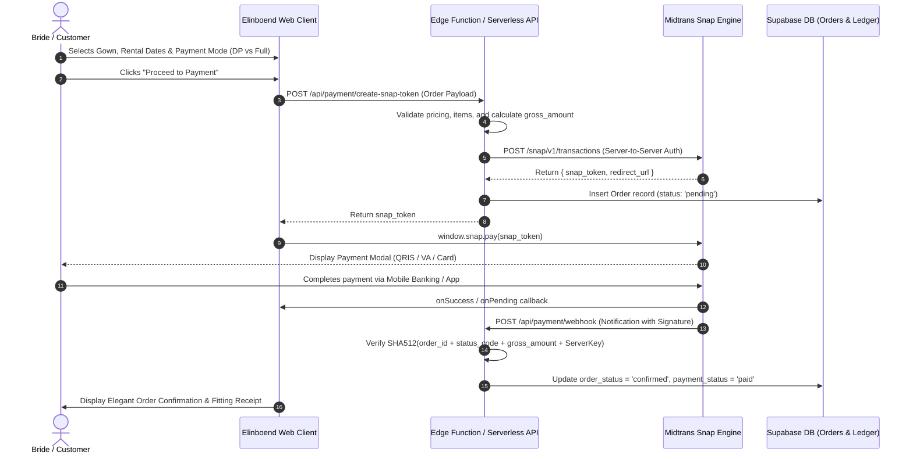

# Payment Gateway Integration Guide - Elinboend Bridal

This document details the architecture, configuration, and transactional workflow for integrating **Midtrans Snap** as the primary payment gateway for Elinboend Bridal.

---

## 1. Overview & Strategy

Unlike standard e-commerce carts with single-item immediate dispatch, bridal boutique transactions require flexible payment arrangements:
1. **Rental Down Payment (DP 50% / 30%)**: Allows brides to secure their wedding gown for a specific wedding date well in advance, with the remaining balance due during the final fitting session.
2. **Full Payment (100%)**: Used for party dress purchases, bridal accessories, or immediate gown rentals.
3. **Refundable Security Deposit (Uang Jaminan)**: Handled transparently during checkout; held in escrow and returned to the client once the gown passes post-event inspection.

---

## 2. Supported Payment Methods (Midtrans Snap)

| Payment Method | Channels / Providers | Settlement Time | Use Case |
|---|---|---|---|
| **QRIS** | GoPay, ShopeePay, BCA Mobile, Livin' Mandiri, Dana, OVO | Instant | Fast mobile booking for fittings or deposit fees |
| **Virtual Account (VA)** | BCA, Mandiri, BRI, BNI, Permata | Instant (Automated callback) | High-ticket bridal gown purchases & rental DP |
| **Credit / Debit Card** | Visa, Mastercard, JCB (3D-Secure OTP) | Instant | Overseas clients, destination weddings, credit installment |
| **E-Wallets** | GoPay / ShopeePay direct link | Instant | Rapid checkout on mobile devices |

---

## 3. Transaction Workflow



---

## 4. API Specification & Payloads

### 4.1 Token Generation Request Payload
Sent by the backend/Edge Function to `https://app.sandbox.midtrans.com/snap/v1/transactions`:

```json
{
  "transaction_details": {
    "order_id": "EB-20261102-0042",
    "gross_amount": 4500000
  },
  "item_details": [
    {
      "id": "GOWN-001-RENT",
      "price": 3500000,
      "quantity": 1,
      "name": "The Royal Ethereal Ballgown (Rental 3 Days)"
    },
    {
      "id": "SEC-DEP-001",
      "price": 1000000,
      "quantity": 1,
      "name": "Refundable Security Deposit (Gown-001)"
    }
  ],
  "customer_details": {
    "first_name": "Elena",
    "last_name": "Kusuma",
    "email": "elena.kusuma@example.com",
    "phone": "+6281234567890",
    "billing_address": {
      "address": "Jl. Bintaro Utama No. 88",
      "city": "Tangerang Selatan",
      "postal_code": "15224",
      "country_code": "IDN"
    }
  },
  "enabled_payments": [
    "qris",
    "bca_va",
    "mandiri_va",
    "bni_va",
    "bri_va",
    "credit_card",
    "gopay",
    "shopeepay"
  ]
}
```

### 4.2 Webhook Signature Verification
To prevent spoofing, incoming notifications from Midtrans must be verified:

$$\text{Signature} = \text{SHA512}(\text{order\_id} + \text{status\_code} + \text{gross\_amount} + \text{MIDTRANS\_SERVER\_KEY})$$

When the computed hash matches `signature_key` in the request header, proceed with database record updates.

---

## 5. Environment Variables Configuration

Create a `.env` file in the root workspace:

```env
# Supabase Configuration
VITE_SUPABASE_URL=https://your-supabase-project.supabase.co
VITE_SUPABASE_ANON_KEY=your-anon-key

# Midtrans Configuration (Client Side)
VITE_MIDTRANS_CLIENT_KEY=SB-Mid-client-xxxxxxxxxxxxxxxx
VITE_MIDTRANS_SNAP_URL=https://app.sandbox.midtrans.com/snap/snap.js

# Backend / Serverless Secret (Do not expose to Vite client)
MIDTRANS_SERVER_KEY=SB-Mid-server-xxxxxxxxxxxxxxxx
MIDTRANS_IS_PRODUCTION=false

# Boutique WhatsApp Concierge Fallback
VITE_WHATSAPP_CONCIERGE_NUMBER=6287772636627
```

---

## 6. Client Implementation Hook (`useMidtransPayment`)

```typescript
import { useEffect } from 'react';

declare global {
  interface Window {
    snap?: {
      pay: (
        token: string,
        options: {
          onSuccess: (result: any) => void;
          onPending: (result: any) => void;
          onError: (result: any) => void;
          onClose: () => void;
        }
      ) => void;
    };
  }
}

export function useMidtransSnap() {
  useEffect(() => {
    const snapScriptUrl = import.meta.env.VITE_MIDTRANS_SNAP_URL || 'https://app.sandbox.midtrans.com/snap/snap.js';
    const clientKey = import.meta.env.VITE_MIDTRANS_CLIENT_KEY;

    if (!document.querySelector(`script[src="${snapScriptUrl}"]`)) {
      const script = document.createElement('script');
      script.src = snapScriptUrl;
      script.setAttribute('data-client-key', clientKey);
      script.async = true;
      document.body.appendChild(script);
    }
  }, []);
}
```
